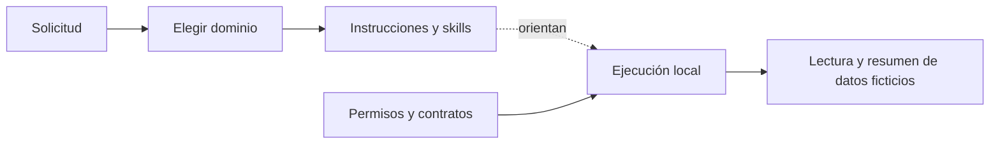

# Agents

Un lugar para definir agentes, elegir quién atiende una tarea y probar su
ejecución con datos ficticios. El sistema vive en **[agentes/](agentes/README.md)**.
Estas guías permiten recorrerlo sin conocer su estructura de antemano.

**Empieza aquí:** [elegir una tarea](agentes/docs/README.md) ·
[entender las carpetas](docs/directorio.md) ·
[leer la arquitectura](agentes/docs/architecture.md) ·
[ver próximos pasos](agentes/docs/roadmap.md)

## Probarlo

Necesitas Node.js 22 o posterior. No hay dependencias que instalar.
Desde la raíz de este repositorio:

```sh
npm run check
npm run demo
node agentes/scripts/route.mjs "explicar ejercicios de universidad"
```

El primer comando comprueba contratos y ejecuta las pruebas. El segundo lee
registros ficticios y calcula un total de 180. El tercero propone un dominio
mediante palabras clave; ante empate pide aclaración.

## Qué hay en cada lugar

| Lugar | Para qué sirve |
| --- | --- |
| [agentes/](agentes/README.md) | Fuente canónica: dominios, skills, reglas, herramientas y pruebas |
| [agentes/docs/](agentes/docs/README.md) | Guías de uso, contratos, seguridad y decisiones |
| [docs/](docs/directorio.md) | Organización del espacio y mapa visual del sistema |
| [DESIGN.md](DESIGN.md) | Criterios visuales de los diagramas |

En el espacio local también pueden existir `Guia/`, un proyecto con Git propio,
y `privado/`, con los perfiles anteriores y el contexto maestro. No forman parte
del contenido publicado. Su ubicación se explica en la [guía del directorio](docs/directorio.md).

## Cómo encajan las piezas



El flujo se muestra con más detalle en el [mapa visual](docs/arquitectura.html).
Descarga ese archivo y ábrelo en un navegador: GitHub muestra su código HTML.
Para explorar archivos y conexiones localmente, consulta
[cómo usar Floorplan](docs/directorio.md#mapa-interactivo-local).

## Estado del proyecto

| Funciona localmente | Sigue pendiente |
| --- | --- |
| Validación de manifiestos y referencias | Migración de las instrucciones originales |
| Router por palabras clave y planes de delegación | Coordinación de procesos y modelos |
| Lectura y resumen de datos ficticios | Conexiones a servicios y memoria persistente |
| Exportación de bundles con hashes | Despliegue e integración con runtimes externos |

Las conexiones están desactivadas. Los planes no inician agentes y los bundles
no acreditan integración con Codex, Cursor, Claude Code o Hermes. Los límites
de ejecución están en la [guía de seguridad](agentes/docs/security.md).
