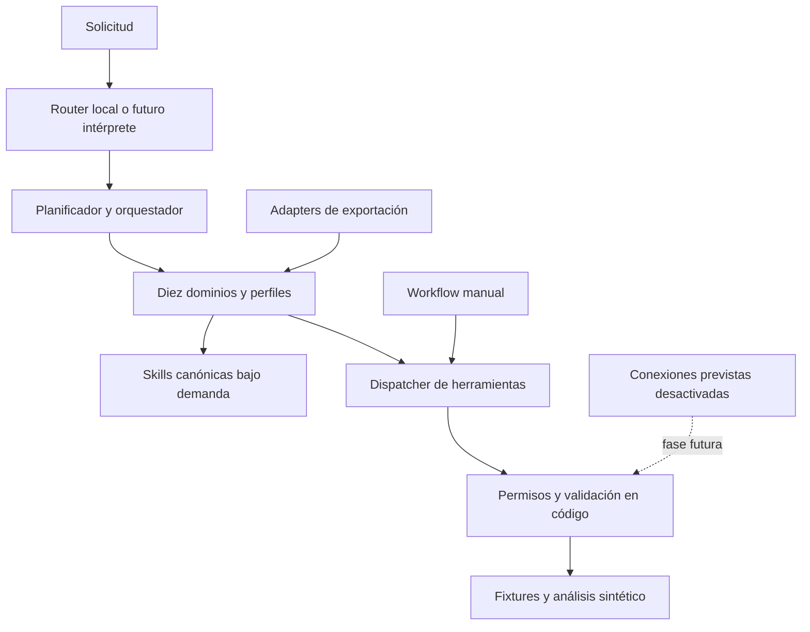

# Arquitectura híbrida

El orquestador coordina diez dominios. Cada dominio tiene instrucciones operativas
AGENTS.md y configuración agent.yaml. Las skills aportan procedimientos; las
herramientas ejecutan operaciones; las conexiones describen acceso a datos; los
workflows secuencian pasos; un scheduler futuro decidirá cuándo activarlos.
Ningún dominio necesita necesariamente un contenedor propio.

Hay tres capas: definiciones canónicas, utilidades ejecutables locales y servicios
futuros. lib/ implementa únicamente la segunda. El router compara tokens con
palabras clave, devuelve candidatos ante empate y solicita aclaración si no hay
coincidencia. No es un clasificador semántico. El planner aplica límites de tareas,
profundidad, concurrencia, presupuesto y deduplicación en una instancia en memoria;
devuelve planes y permisos intersectados. No coordina procesos, reinicios o colas.

El workflow de ejemplo asigna lectura a Personal y resumen a Finance. Es una
secuencia fija ejecutada en un proceso; los nombres de dominio describen quién
responde por cada paso. No se simula conversación ni generación mediante modelos.
Las acciones pasan por el dispatcher con schemas de entrada/salida y hooks locales.

Academic conserva dos perfiles: Profesor-Tutor enseña, explica, formula ejercicios
y adapta profundidad; Compañero de Universidad colabora en trabajos, documentos,
investigación y presentaciones. Los demás perfiles originales se mapean a un
dominio cada uno. Su contenido completo se importará posteriormente; no se
reconstruye a partir de los nombres. Personal, Finance y Commercial son nuevos.

Los ámbitos Personal OS, Business OS y Financial OS son vistas funcionales; no
son tres agentes adicionales. El número preliminar de dieciocho especialistas
no es una decisión cerrada. Quantitative y Acquisitions siguen siendo candidatos
a subagentes; no se crean ejecutores sin evaluación.

AGENTS.md raíz y los de cada dominio son fuentes jerárquicas, sin cuatro versiones
manuales por runtime. Cada skill tiene un solo SKILL.md y manifiesto. Los bundles
son derivados descartables con hashes. Las convenciones y límites de exportación
se documentan en [adapters](../adapters/README.md).

El HP con Ubuntu 24.04 LTS es el destino planificado. Este directorio se construye
en el entorno de trabajo actual; no acredita inventario, instalación ni despliegue
en el HP. El almacenamiento real será privado y local, fuera del repo. El Site
Homelab OS mantiene estado en navegador con importación/exportación manual; no
hay sincronización, credenciales ni dependencia operativa respecto del Site.
